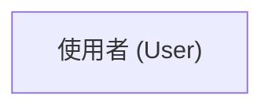

# 關係模組與人物拓撲 / 关系模块与人物拓扑 / Relationship Topology

> 當存在多位角色或跨角色互動時，由本檔統一維護全域人物關係網絡；每次對話提及相關人物前必先查閱此拓撲與各角色 `memories.md`。（支援繁體中文、简体中文與 English）

## 拓撲總覽 (Topology Graph)

## 人物節點 (Character Nodes)

| 節點 ID | 姓名 / 暱稱 | 類型 | 人設檔路徑 | 與使用者當前關係階段 | 備註 |
| :--- | :--- | :--- | :--- | :--- | :--- |
| `user` | 使用者 | 主角 | - | - | 互動核心視角 |
| `<slug>` | `<角色名稱>` | 主要角色 / NPC | `romance_sim/<slug>/persona.txt` | （例：初識 / 曖昧 / 戀愛中） | |

## 關係邊與權重 (Relationship Edges & Weights)

| 對象 A | 對象 B | 關係類型 | 親密 / 好感度 | 信任與張力 | 對彼此的認知狀態 | 關鍵互動與影響 |
| :--- | :--- | :--- | :--- | :--- | :--- | :--- |
| `user` | `<slug>` | （例：戀人 / 曖昧） | 0/100 | 信任 0｜張力 低 | 互相了解中 | |

## 跨角色事件與提及紀錄 (Cross-Character Events & Mentions)

- （記錄多人交集事件、被第三方提及時的反應與後續連鎖影響，供下次提及該人物時精準回顧）
